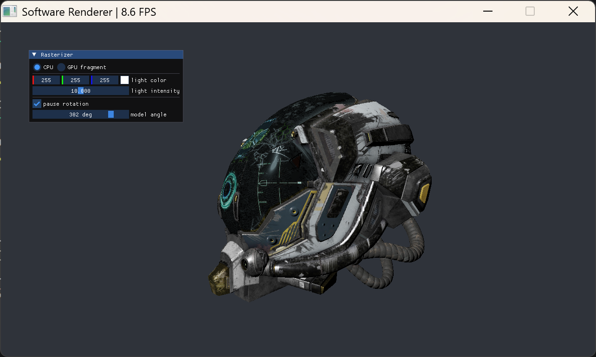
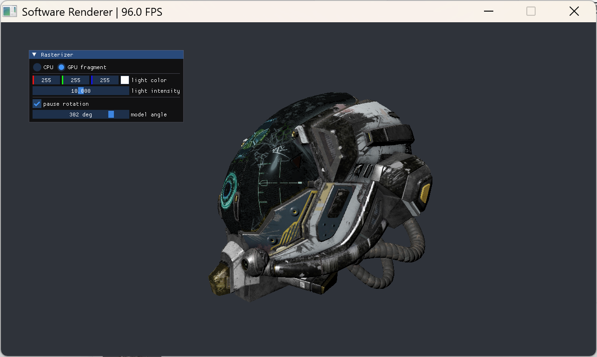
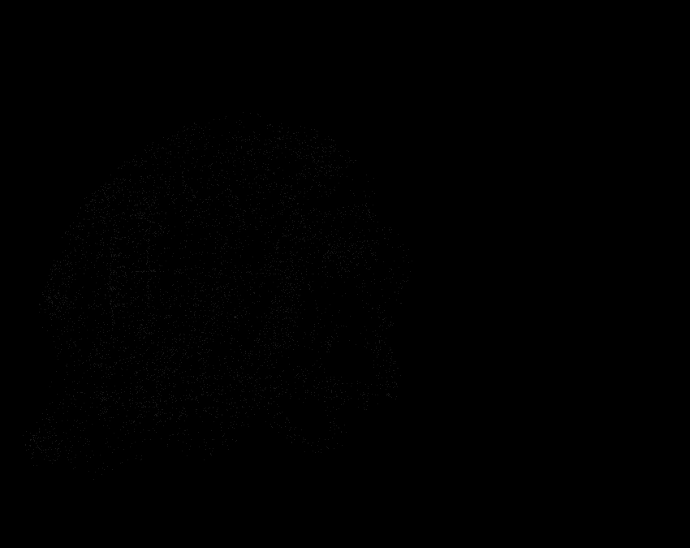
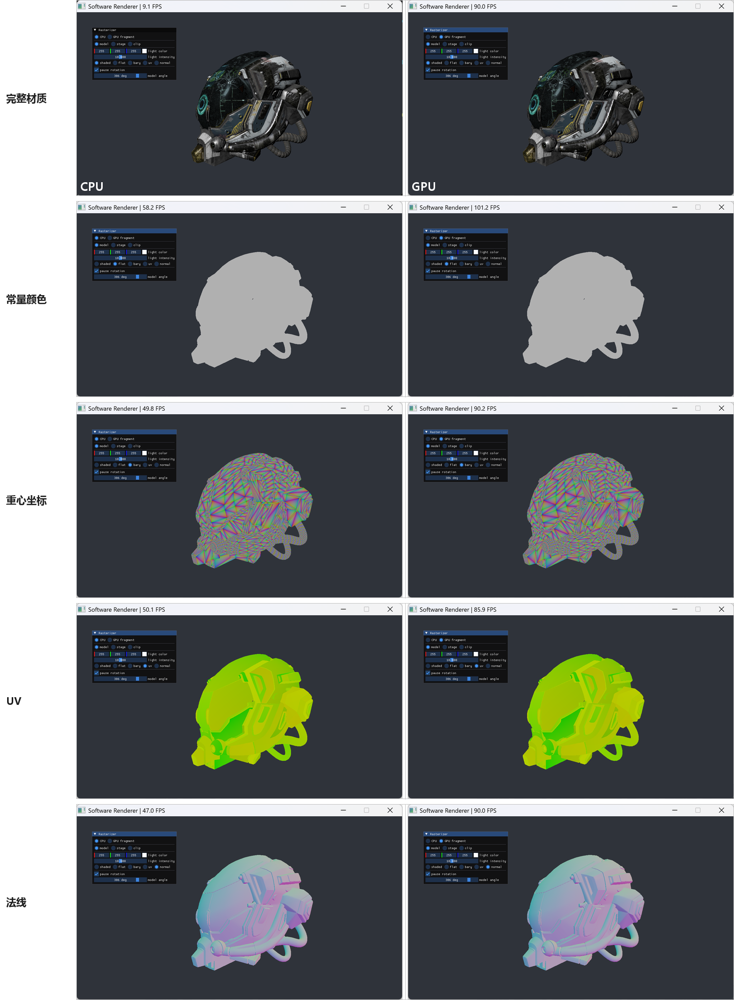
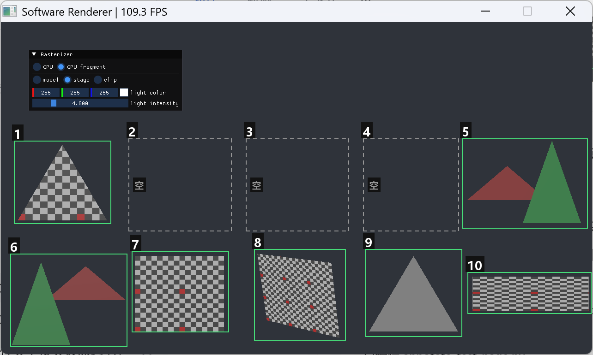
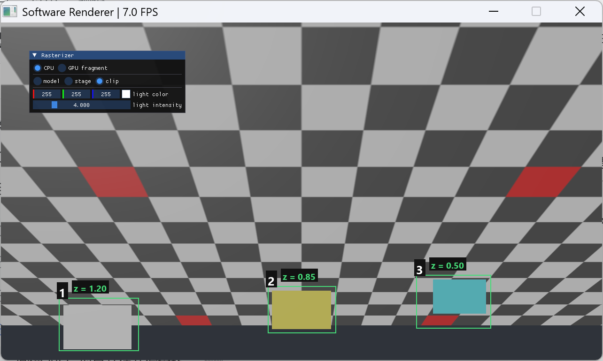
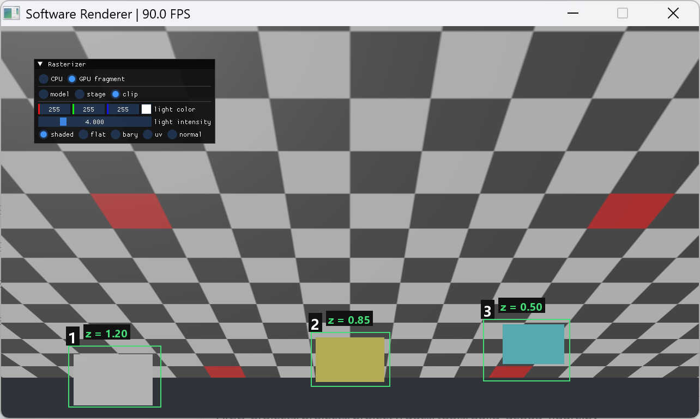

# Project 1 实验报告：软件渲染器（CPU / GPU 双路径光栅化）

> 课程：计算机图形学　｜　工程：`AICG-projects/projects/project1`
> 
> 姓名：张雪松　学号：3260400091
>
> 目标：在同一场景、同一相机、同一材质与光照下，用 **CPU(C++)** 与 **GPU(GLSL)** 两套独立实现完成同一条光栅化管线，并对比结果与性能。
>
> 本报告位于 `projects/project1/report.md`；截图在 `docs/images/`，全部数值可用 `docs/tools/` 下的脚本复现。

---

## 1. 运行环境

| 项目 | 配置 |
| --- | --- |
| 操作系统 | Windows 11（Build 26100，x64） |
| CPU | Intel Core Ultra 5 125H（18 线程） |
| GPU | NVIDIA GeForce RTX 4050 Laptop（驱动 32.0.15.9649）；另有 Intel Arc 核显（32.0.101.8243） |
| OpenGL | 4.6 上下文（作业要求 4.1 Core） |
| 编译器 | GCC 15.1.0（MinGW-w64，UCRT，posix-seh） |
| 语言标准 | C++20（使用 `std::format`） |
| 构建工具 | CMake 4.4.5 + Ninja 1.13.2，`-DCMAKE_BUILD_TYPE=Release` |
| 依赖管理 | vcpkg manifest 模式，`x64-mingw-dynamic` triplet（target 与 host triplet 相同），baseline `e456309491fd875487bf02b8a0dca76c1b1b00cc` |
| 窗口 / 分辨率 | 1280×720 窗口，帧缓冲 1280×720 |
| 垂直同步 | 开启（`main.cpp` 中 `vsync = true` → `glfwSwapInterval(1)`） |
| 帧率口径 | 标题栏 FPS 由 `getDeltaTime()` 反算，是**整帧帧率**（含 ImGui、资源上传与交换），不是光栅化内核耗时 |

> **关于构建路线的说明**：本机未安装 Visual Studio，因此没有走 README 2.2 的 MSVC 路线，改用 MinGW-w64 + Ninja + vcpkg 的 MinGW triplet。除 triplet 选择外，源码与本报告的全部结论与 README 的默认流程无关；碰到的问题与修法记在 10.2 节，便于复现。

---

## 2. 完成情况

### 2.1 第一部分：CPU 光栅化器（`src/cpu_renderer.cpp`）

| 任务 | 函数 | 完成内容 | 公式见 |
| --- | --- | --- | --- |
| CPU-1 | `clipAgainst()` | Sutherland–Hodgman 单平面裁剪，对 `clip/worldPosition/normal/uv` 四个属性同时做线性插值；临时数组容量 `kMaxClippedPolygonVertices = 9` | 3.3 |
| CPU-2 | `buildScreenTriangles()` | 透视除法、视口映射、深度映射；用有符号面积剔除背面/退化三角形；由世界边与 UV 差构造切线基 | 3.2、3.4、3.6 |
| CPU-3 | `rasterizeTriangles()` | 边函数覆盖测试，遍历三角形屏幕包围盒，采样点取像素中心 | 3.4 |
| CPU-4 | 同上 | 屏幕重心插值窗口深度，`z ≥ depthBuffer[p]` 丢弃并写回（近者胜） | 3.5 |
| CPU-5 | 同上 | `1/w` 修正后插值世界位置/法线/UV，调用 `pbrShade()` 写入线性 HDR 颜色缓冲（不 clamp） | 3.6 |

### 2.2 第二部分：GPU 光栅化器

| 任务 | 文件 | 完成内容 | 公式见 |
| --- | --- | --- | --- |
| GPU-1 | `assets/shaders/transform.vert` | 经 Transform Feedback 输出 48 字节 `ClipVertex`（`tfClip/tfWorldPosition/tfNormal/tfUv`），与 C++ 结构体逐字节对齐 | 3.2 |
| GPU-2 | `assets/shaders/raster_bounds.geom` | 与 CPU 同形的六平面裁剪，固定容量 `ClipVertex clipped[9]` | 3.3 |
| GPU-3 | 同上 | 屏幕转换：`invW/ndc/screen/depth`，逐项对应 CPU 公式，写入 `gScreenAndInvW` | 3.4 |
| GPU-4 | 同上 | 受 `max_vertices = 21` 限制，每个扇形三角形只发 **3 个顶点**的包围盒大直角三角形 | 3.7 |
| GPU-5 | `assets/shaders/raster_shading.frag` | 覆盖测试与背面剔除（`area <= 0` 或任一重心为负 → `discard`） | 3.4 |
| GPU-6 | 同上 | 把屏幕重心插值的深度写入 `gl_FragDepth`，比较交给 OpenGL（`GL_LESS`） | 3.5 |
| GPU-7 | 同上 | `1/w` 修正插值属性，切线基同 CPU，最后调用 `pbrShade()` | 3.6 |

### 2.3 附加改动

| 文件 | 内容 | 对应要求 |
| --- | --- | --- |
| `include/software_renderer_app.h`、`src/software_renderer_app.cpp` | 模型角改为可累积可冻结的 `m_modelAngle`；UI 增加 `pause rotation`、`model angle` | 第 10 节 可选扩展 |
| `include/debug_scene.h`（新增） | 程序化测试场景：`stage` 页 10 个测试单元、`clip` 页 1 个跨近裁剪面的大三角形 + 3 个深度标记 | 第 8.2 节 |
| `include/raster_types.h`、`src/cpu_renderer.cpp`、`src/gpu_renderer.cpp`、`assets/shaders/raster_shading.frag` | `FrameState::debugView` + 两侧一致的调试视图分支（常量色/重心/UV/法线） | 第 8.1 节 |

### 2.4 已知限制

- CPU 路径单线程逐像素着色，1280×720 下约 8~9 FPS，属预期量级（未做多线程优化）。
- 片元着色器写 `gl_FragDepth` 会关闭 early-Z；这是“手写深度”的必然代价（见 5.3）。
- 候选图元按包围盒外扩发射，细长三角形会浪费片元，正确性不受影响（见 5.2）。
- 调试视图的输出同样经过 `display.frag` 的 Reinhard + gamma，因此中间结果的绝对颜色被压缩，但各通道仍单调，不影响判读。

---

## 3. 关键算法与坐标约定

### 3.1 坐标与数值约定（两条路径完全一致）

- 裁剪空间 → NDC：`ndc = clip.xyz / clip.w`。
- 屏幕空间：**原点在左下角，Y 轴向上**，`screen = (ndc.xy × 0.5 + 0.5) × extent`。
- 像素中心 `(x + 0.5, y + 0.5)`；`gl_FragCoord.xy` 恰为该中心，因此 CPU 的采样点与 GPU 的片元中心天然重合。
- 深度 `depth = ndc.z × 0.5 + 0.5 ∈ [0,1]`，越小越近，清屏值 1.0。
- 颜色缓冲保存**线性 HDR**，不 clamp；Reinhard 与 gamma(1/2.2) 统一在 `display.frag` 最后一步完成。
- 每帧只清一次颜色/深度，所有绘制项共享同一深度缓冲（见 Q4）。

### 3.2 顶点变换与 Transform Feedback 布局

```
world = model · pos
clip  = projection · view · world
n     = normalize( transpose(inverse(mat3(model))) · aNormal )
```

非均匀缩放下法线矩阵与其逆转置才正确（stage 页第 10 项专门验证这一点）。GPU 把上述结果经 Transform Feedback 抓回缓冲，后续几何阶段以该缓冲为顶点源，保证与 CPU 使用**完全相同**的中间数据；`ClipVertex` 为 48 字节，`static_assert` 校验了四个字段的偏移量（0/16/28/40）。

### 3.3 齐次空间裁剪

对 6 个裁剪平面（`(±1,0,0,1)`、`(0,±1,0,1)`、近、远）依次做 Sutherland–Hodgman，保留 `dot(plane, clip) ≥ 0` 的部分；跨越平面时

```
t = d_from / (d_from − d_to)
P = mix(P_from, P_to, t)        // clip / world / normal / uv 四个属性同时插值
```

三角形经 6 个平面裁剪后最多 9 个顶点，两条路径都用固定容量数组；顶点数 < 3 即整三角形剔除，否则按 `(0,1,2), (0,2,3), …` 组成扇形。

**必须在透视除法之前裁剪**：近平面之后的点 `w ≤ 0`，直接除以 `w` 会符号翻转或数值爆炸（详见 Q1）。

### 3.4 覆盖测试与重心坐标

```
area = cross(b − a, c − a)
λa = cross(b − p, c − p) / area
λb = cross(c − p, a − p) / area
λc = cross(a − p, b − p) / area
```

`area ≤ 0` 为背面或退化（本工程约定正面为逆时针）；`λ` 全非负即像素中心落在三角形内，且 `λ` 就是重心坐标。CPU 遍历包围盒整数像素；GPU 由候选图元产生片元，再用**同一组公式**在片元着色器里筛掉三角形外的碎片。

### 3.5 深度

窗口深度对屏幕坐标是仿射的，直接用屏幕重心的加权和：

```
z = Σ λᵢ zᵢ
```

`z < depthBuffer[p]` 时通过并写回；GPU 把同一数值写入 `gl_FragDepth`，由 `GL_LESS` 完成比较。

### 3.6 透视正确插值与切线基

```
qᵢ = λᵢ · invWᵢ,     wᵢ = qᵢ / (q₀ + q₁ + q₂)
attr = Σ wᵢ · attrᵢ        // world position / normal / uv
```

切线基由世界空间边与 UV 差解出（`|det| ≤ 1e-12` 时保留默认轴 `(1,0,0)/(0,1,0)`）：

```
det = d1.x·d2.y − d2.x·d1.y
T   = (E1·d2.y − E2·d1.y) / det
B   = (E2·d1.x − E1·d2.x) / det
```

### 3.7 GPU 三段式管线与“大直角三角形”

```
transform.vert  ──TF──►  48B ClipVertex × N
                            │
raster_bounds.geom  ◄───────┘   裁剪 → 屏幕转换 → 扇形三角化
       │                        每个三角形发 1 个包围盒大直角三角形
       ▼
raster_shading.frag             覆盖测试(discard) → gl_FragDepth → 透视修正 → pbrShade
```

`max_vertices = 21` 是本题的硬约束：9 个顶点的多边形扇形三角化最多 7 个三角形，平均每个三角形只剩 3 个顶点的配额，**无法**用两个三角形拼出包围盒矩形。采用的技巧是发射一个直角三角形，让斜边恰好擦过外扩 1 像素后的包围盒远角：

```
lower = min(v0, v1, v2) − 1
upper = max(v0, v1, v2) + 1
span  = max(upper − lower, vec2(2))
corners = { lower, lower + (2·span.x, 0), lower + (0, 2·span.y) }
```

该三角形内接的矩形恰为 `[lower.x, lower.x + 2·span.x] × [lower.y, lower.y + 2·span.y]`，而 `upper` 只到 `lower + span`，故整个包围盒严格位于三角形内部，候选区域只多不少。

---

## 4. 结果证据

### 4.1 固定姿态对比（1280×720，模型角 302°）

| CPU（8.6 FPS，≈116 ms/帧） | GPU fragment（96.0 FPS，≈10.4 ms/帧） |
| --- | --- |
|  |  |

轮廓、遮挡（面罩与管线的前后顺序）、贴图（划痕、黄色标识、青色圆环）、法线细节与金属高光位置全部一致，肉眼无法区分——这正是两条独立实现相互验证的目的。

### 4.2 逐像素数值对比

对**纯 3D 渲染区域**（排除标题栏、ImGui 面板与窗口边框，850×675 像素）逐像素做差：

| 指标 | 数值 |
| --- | --- |
| 完全一致的像素 | **99.02 %** |
| 平均绝对误差 | 0.004 / 255 |
| 最大绝对误差 | 6 / 255 |
| 差异像素的误差中位数 | 1 / 255（1 个量化单位） |
| 差异像素处的图像梯度均值 | 34.5（全图均值 6.0，约 6 倍） |

可用 `python docs/tools/diff_cpu_gpu.py` 复现并重新生成差异图。

差异集中在轮廓边缘与高频纹理处，量级 1~6 个量化单位，来源是浮点舍入、8 位量化与边缘像素的临界判定，属于 README 8.2 所说“浮点运算、边界精度和 HDR 存储可能产生的局部偏差”，**不存在几何缺失、错误遮挡、纹理扭曲或闪烁**。差异图（放大 24 倍）中可见误差只沿轮廓呈细线分布：



---

## 5. 调试分析

本节只记录**渲染管线与验证工具本身**的问题；构建环境相关的问题放在 10.2 节。

### 5.1 三个实现取舍

**背面剔除必须放在片元着色器**
GPU 侧几何阶段发射的是人为构造的包围盒三角形，其绕序恒为逆时针、与原三角形无关，因此 `GL_CULL_FACE` 既会误杀也会漏杀；基础工程本身也没有开启面剔除。于是把“逆时针为正”的判定放到片元着色器：`area <= 0` 即 `discard`，与 CPU 的判据完全一致——这也是 8.1 中 `flat` 视图能做到逐位相同的前提之一。

**每个扇形三角形只发 3 个顶点**
`max_vertices` 是**几何着色器实例级**的顶点上限：9 顶点多边形扇形化最多 7 个三角形，若每个三角形发 6 个顶点（两个三角形拼包围盒）需要 42 > 21，图元会被直接丢弃。因此改成 3.7 节的单个大直角三角形，并外扩 1 像素保证包围盒严格落在斜边之内。

**深度写 `gl_FragDepth` 的代价**
窗口深度对屏幕坐标本来就是仿射的，直接 `Σλᵢzᵢ` 即可；但一旦写 `gl_FragDepth`，early-Z 就失效，候选区域外的碎片会真正进入着色器再被 `discard`。这是第 6 节 GPU 路径固定开销的主要来源，也是“手写深度”的教学代价。

### 5.2 测试场景的返工（现象 → 定位 → 修法）

验证工具本身先要正确，否则会把场景错误当成渲染错误。本次共踩到以下几处：

| 现象 | 定位依据 | 修法 |
| --- | --- | --- |
| `clip` 页“糊满屏”，无法判断裁剪是否正确 | 跨近裁剪面的三角形，被裁出的新顶点都落在 `w ≈ near` 上，投影后 NDC 达几十，**必然覆盖整个视口**——满屏不是判据 | 改用“可见部分是否是一致透视图像、相机后那半是否被丢弃”作判据，并叠加不同深度的标记验证前后关系 |
| `stage` ⑦ 两个“共享边”的三角形中间裂开一条缝 | 顶点坐标写错：两个三角形只在端点相接，并未共边 | 改为沿正方形对角线切分，顶点完全共用 |
| `stage` ⑧ 倾斜棋盘整体发黑 | 旋转到 `-55°` 后法线背向光源，`nDotL ≈ -0.18`，着色结果本就为 0 | 改为绕 Y `-35°`、绕 X `12°`，`nDotL ≈ 0.60` |
| 棋盘色的色带占每格一半，整屏呈红绿条纹 | 色带宽度按**整张纹理**算（`size/16 = 16px`），而格子只有 `size/8 = 32px` | 按格宽比例计算色带宽度；最终索性改回自带红角标的灰棋盘，方向性由角标提供 |
| 设计为“应被遮挡”的青色标记却看不见 | 该标记深度 3.10 小于背景平面在该处的深度 3.39，本来就该被遮住——是场景设计错误，不是渲染错误 | 重排标记深度为 2.40 / 2.75 / 3.10，全部小于 3.39 |
| 白色标记完全不出现 | 白色标记 x 坐标 `-1.8`、深度 2.4 处视锥半宽只有 `ndc 0.725`，`-1.8/2.4 = -0.75` 已在视锥外，被正确裁掉 | 标记移到 `x = ±1.2`、`y = -0.80` |
| `stage` ⑩ 与 ⑨ 重叠且右端被窗口切掉 | 非均匀缩放 `scale(1.7, 0.45, 1)` 使宽度达 326px，而列距只有 253px | 改为 `scale(1.3, 0.45, 1)` |

### 5.3 对比工具自身的故障：`max 186` 其实是窗口边框

- **现象**：第一次对整窗做逐像素比较，得到“最大误差 186/255、5542 个像素误差 > 32/255”，看起来像严重的渲染分歧。
- **定位**：把误差 > 32 的像素画成掩码后，它们连成窗口四周一圈 1 像素细框，与场景内容无关；再检查坐标，全部落在 `x ∈ {0, 1279~1283}` 与 `y ∈ {0, 769}`。
- **修法**：对比区域改为排除 6 像素窗口边框与 ImGui 面板，同一对截图的最大误差从 186 降到 1/255。结论：差异工具必须先把窗口装饰排除在外，否则会把合成器绘制的内容算进渲染误差。

---

## 6. 性能对比

条件：Release、1280×720、同一模型/相机/材质/灯光、固定姿态 302°、窗口状态一致。

| 路径 | 帧率 | 单帧耗时 | 相对加速 |
| --- | --- | --- | --- |
| CPU（单线程，逐像素 PBR） | 8.6 FPS | ≈116 ms | 1× |
| GPU fragment（三段式） | 96.0 FPS | ≈10.4 ms | **≈11.2×** |

结论：软件渲染的瓶颈在“逐像素采样材质 + 着色”，1280×720 全屏的候选片元在 CPU 上只能串行处理；GPU 把同样的数学工作分摊到数千个着色器核心，即便刻意保留了“手工裁剪 + 手工深度 + 覆盖测试”这些低效环节（候选区域大于真实三角形、early-Z 失效），仍有约一个数量级的提升。

> 口径说明：标题栏 FPS 是整帧帧率，包含 ImGui、资源上传与交换等待。两条路径都包含这些**固定开销**，因此 11.2× 是偏保守的估计——固定开销在 GPU 的 10.4 ms 里占比更大。绝对帧率会随窗口是否前台、垂直同步设置而变，本报告只做同一口径下的相对比较。

---

## 7. 算法分析题

**Q1 为什么要在透视除法之前裁剪？跨越近裁剪面时直接除以 `w` 会怎样？**
近平面之后顶点 `w ≤ 0`。直接做 `ndc = clip/w` 会出现符号翻转（`w < 0` 时 x/y 反向）或数值爆炸（`w → 0`），三角形在屏幕上“翻面”甚至覆盖整屏；`w = 0` 还产生 NaN/Inf 污染后续插值。先裁剪保证进入屏幕映射的点都在 `0 < w` 且位于视锥内，`ndc` 落在 `[-1,1]`，除法安全。

**Q2 为什么深度可以按屏幕重心坐标插值，而 UV 需要 `1/w` 修正？**
透视投影对世界坐标不是仿射变换，但窗口深度 `z_ndc = z_clip/w_clip` 已经把透视除法吸收进去，它在屏幕空间对 `(x,y)` 是仿射的，所以屏幕重心线性插值即正确。而 UV/法线/世界位置是 3D 空间中的线性量，投影后变化率被 `1/w` 缩放，必须用 `wᵢ = λᵢ·invWᵢ / Σ` 修正，否则近处被压缩、远处被拉伸（经典的“纹理向远处扭转”）。

**Q3 GPU 已经能产生片元，为什么还要在片元着色器里测试原三角形的覆盖？**
因为发射的不是原三角形，而是覆盖其包围盒的大直角三角形——片元只是候选，绝大多数落在真实三角形之外；基础工程也没有开启面剔除，背面同样产生片元。所以覆盖测试与背面剔除都必须由片元着色器用边函数完成，这也顺带让 GPU 与 CPU 的采样点、判定公式完全一致。

**Q4 如果每个绘制项都清空深度缓冲，会出现什么现象？**
后绘制的物体会无条件覆盖先绘制的物体，遮挡退化为“绘制顺序决定一切”（画家算法）：本应被挡住的内腔、背面会穿透显示，模型自遮挡错乱，同一帧内不同绘制项之间的深度信息丢失。正确做法是每帧只清一次颜色/深度，绘制项共享同一缓冲。

**Q5 如何构造一个能暴露裁剪交点属性插值问题的小场景？**
取一个跨近裁剪面的大三角形：两个顶点在近平面前方、一个在后方（`w < 0`），三个顶点给差异明显的 UV（如 (0,0)、(4,0)、(0,4)），并铺一张方向性明确的棋盘纹理。正确实现会在 `t = d_from/(d_from − d_to)` 处插值出交点属性，裁剪边界处纹理连续性不破；若错误地先在屏幕空间插值再裁剪（或 `t` 用未归一化距离），边界处会出现纹理跳变、拉伸甚至越界采样。把三角形绕成细长条可进一步放大误差。本报告的 `clip` 页正是这一场景的实现（见 8.2）。

---

## 8. 测试与验证

### 8.1 分阶段调试（中间结果可视化）

ImGui 面板新增 `shaded / flat / bary / uv / normal` 五个视图，CPU 与 GPU 走同一编号（`FrameState::debugView` 与 `uniform int uDebugView`），因此**同一视图的两张图应当逐像素一致**——这本身又是一条等价性证据。



| 视图 | 输出内容 | 判定标准 |
| --- | --- | --- |
| `shaded` | 完整 PBR | 与 CPU 完全一致、贴图/高光/遮挡正确 |
| `flat` | 常量 `0.8` 灰 | 形状即覆盖范围：无空洞、无溢出、边缘干净 |
| `bary` | 屏幕重心 `(λa, λb, λc)` 作为 RGB | 三角形内部三色渐变；每个三角形边界处必有一条通道为 0（暗线）；若有三角形“少一角”说明覆盖测试或扇形三角化错了 |
| `uv` | `(u, v, 0)` 作为 RGB | 贴图接缝处出现折线；同一 UV 岛内颜色连续；若出现整体翻转说明 UV 的 v 轴约定错 |
| `normal` | `n × 0.5 + 0.5` | 朝向相机的面接近蓝色系；侧向面偏红/绿；接缝处无突跳说明法线矩阵正确 |

CPU 与 GPU 在 306° 姿态下的逐像素一致性（排除窗口边框与 ImGui 面板，841752 像素）：

| 视图 | 完全一致 | 平均误差 | 差异中位数 | 误差 > 2/255 的像素 |
| --- | --- | --- | --- | --- |
| `flat` | **100.000 %** | 0.0000 | — | **0** |
| `shaded` | 99.360 % | 0.0065 | 1/255 | 6 |
| `bary` | 99.204 % | 0.0084 | 1/255 | 4 |
| `uv` | 99.490 % | 0.0052 | 1/255 | 4 |
| `normal` | 99.218 % | 0.0081 | 1/255 | 4 |

`flat` 视图与几何/着色细节完全无关，只依赖覆盖判定，因此能做到**逐位相同**；其余视图的差异几乎都只有 1 个量化单位，超过 2/255 的像素每张图不超过 6 个，全部位于轮廓上采样点恰好落在三角形边上的位置（浮点舍入使两条路径的“在/不在”判定相反）。

### 8.2 针对性测试场景

`stage` 页把 README 8.2 的十种情况并排放在同一画面（`include/debug_scene.h`，程序化生成、无外部资源），`clip` 页专门测试跨近裁剪面。两页均为世界坐标直接构造、不随模型旋转，保证 CPU/GPU 可逐像素对比。

| # | README 8.2 场景 | 本实现的构造 | CPU | GPU |
| --- | --- | --- | --- | --- |
| 1 | 单个正面三角形 | 带棋盘贴图的三角，`(u,v)=(0,0)` 处有红色角标 | 通过（红角标在左下，u/v 方向正确） | 通过 |
| 2 | 反转顶点顺序 | 同形状但绕序反向 | 空（0 像素） | 空 |
| 3 | 三点共线 | 面积为 0 的退化三角形 | 空 | 空 |
| 4 | 完全位于一个裁剪面外 | 顶点 `z = +5.0`，整体位于相机背后 | 空 | 空 |
| 5 | 跨越裁剪面 | `clip` 页大三角形：两顶点在世界坐标 `z = −0.5`（距相机 4.1），一顶点在 `z = +4.6`（相机背后，`w < 0`），同时跨越 near / left / right 三个裁剪面 | 见下方 clip 图 | 见下方 clip 图 |
| 6 | 两个不同深度的重叠三角形 | 近的绿三角先画、远红三角后画 | 远者仍被遮挡 | 同左 |
| 7 | 两个独立绘制项相互遮挡 | 同一对三角形反序绘制（红先绿后） | 结果与 6 完全相同 | 同左 |
| 8 | 倾斜棋盘格平面 | 绕 Y 轴 −35°、绕 X 轴 12° 的棋盘四边形 | 格子随透视收缩、无扭曲 | 同左 |
| 9 | 共享边的两个三角形 | 正方形沿对角线切成两个三角形 | 对角线处无裂缝也无重复覆盖 | 同左 |
| 10 | 退化 UV / 非均匀模型缩放 | ①全部 UV 为 (0.5,0.5)：纯色；②`scale(1.3,0.45,1)`：明暗均匀 | 通过 | 通过 |

**stage 页（左 CPU 37.5 FPS｜右 GPU 109.3 FPS），编号 1–10 对应上表**：

| CPU | GPU |
| --- | --- |
|  |  |

**clip 页（跨近裁剪面 + 三个深度标记）**：标记深度分别为 2.40（白）/ 2.75（黄）/ 3.10（青），背景平面在该处的深度为 3.39，因此三者都**可见**；若深度插值、`gl_FragDepth` 或深度测试任一处写错，青色标记会先消失。

| CPU（7.0 FPS） | GPU（90.0 FPS） |
| --- | --- |
|  |  |

两页的 CPU/GPU 逐像素一致性：

| 场景页 | 完全一致 | 平均误差 | 最大误差 |
| --- | --- | --- | --- |
| `stage`（841752 像素） | **99.638 %** | 0.0036 / 255 | 1 / 255 |
| `clip`（841752 像素） | **98.271 %** | 0.0173 / 255 | 1 / 255 |

`clip` 页的“完全一致”比例更低、但最大误差只有 1/255：整屏棋盘纹理在掠射角下被强烈缩小，两条路径在 UV 透视修正、纹理采样滤波与 8 位量化上的浮点舍入会让个别像素差一个量化单位。这不是几何或深度差异——若裁剪或深度出错，误差会是整片区域、上百个量化单位量级。

### 8.3 测量条件的对齐

README 8.3 要求固定 Release、分辨率、模型、相机、材质、灯光后记录性能。本报告的所有帧率均满足：同一台机器、同一 Release 构建、1280×720、同一模型与光照、`pause rotation` 冻结同一角度（4.1 与 6 节为 302°，8.1 的调试图为 306°），并且**同一窗口状态**下连续读取标题栏读数。

---

## 9. 可选扩展（已实现）

1. **暂停旋转 / 固定角度**：`pause rotation` 复选框 + `model angle` 滑条（0~360°）。模型角由 `m_modelAngle` 累积，冻结后两条路径可在完全相同姿态下截图——这是第 4 节全部对比图的前提。
2. **分阶段调试视图**：`shaded / flat / bary / uv / normal` 五种输出，CPU 与 GPU 共用同一编号，见 8.1。
3. **程序化测试场景**：`stage` / `clip` 两页，覆盖 README 8.2 的十种情况，见 8.2。

---

## 10. 复现步骤

### 10.1 构建与运行

```powershell
# 1. 依赖（一次性）
pip install -i https://pypi.tuna.tsinghua.edu.cn/simple cmake ninja
git clone https://github.com/microsoft/vcpkg.git D:\vcpkg
D:\vcpkg\bootstrap-vcpkg.bat -disableMetrics
$env:VCPKG_ROOT = 'D:\vcpkg'
$env:VCPKG_DEFAULT_HOST_TRIPLET = 'x64-mingw-dynamic'

# 2. 配置与构建
cd <repo>\projects\project1
cmake -S . -B build -G Ninja -DCMAKE_BUILD_TYPE=Release `
      -DCMAKE_CXX_COMPILER="C:/Program Files/mingw64/bin/g++.exe" `
      -DVCPKG_TARGET_TRIPLET=x64-mingw-dynamic
cmake --build build --parallel

# 3. 运行
.\build\software_renderer.exe
```

运行后：默认 `CPU`；点 `GPU fragment` 切换后端；`model` / `stage` / `clip` 切换场景；`shaded…normal` 切换调试视图；`ESC` 退出。

### 10.2 MinGW 路线遇到的两个问题（供复现者参考）

| 现象 | 原因 | 修法 |
| --- | --- | --- |
| `error: in triplet x64-windows: Unable to find a valid Visual Studio instance` | `VCPKG_TARGET_TRIPLET` 已是 mingw，但**默认 host triplet** 仍是 `x64-windows`，它硬性要求 MSVC/vswhere；而 `vcpkg.cmake` 只向 `vcpkg install` 传 `--triplet`，不传 host triplet | 设环境变量 `VCPKG_DEFAULT_HOST_TRIPLET = 'x64-mingw-dynamic'` |
| 依赖下载阶段报 `schannel: ... CRYPT_E_NO_REVOCATION_CHECK` | vcpkg 自带下载器的证书吊销检查在代理环境下无法完成（证书链本身没问题） | 用 `curl.exe -L --ssl-no-revoke -o <文件名> <URL>` 预先把文件放入 `downloads\`，vcpkg 校验哈希后会跳过下载 |

> 运行前需保证 `build\glfw3.dll` 存在：dynamic triplet 链接的是 `libglfw3dll.a`，但 vcpkg 不会自动把运行期 DLL 拷贝到可执行文件旁，可从 `build\vcpkg_installed\x64-mingw-dynamic\bin\glfw3.dll` 复制。

### 10.3 复现本报告中的数值

```powershell
cd projects\project1
python docs\tools\diff_cpu_gpu.py         # 4.2 的逐像素对比与差异图
python docs\tools\annotate_test_page.py docs\images\test_stage_cpu.png stage docs\images\test_stage_cpu_annotated.png
python docs\tools\build_debug_figure.py   # 8.1 的拼图 + 8.1/8.2 的全部一致率数字
```

---

## 11. 参考资料与 AI 使用声明

**使用的资料与工具**

| 来源 | 用途 |
| --- | --- |
| 课程框架 `base/`、`projects/project1/README-zh.md` | 接口约定、任务清单与验收标准 |
| `DamagedHelmet.gltf`（框架自带资源） | 主场景模型与 PBR 贴图 |
| 《OpenGL 4.5 / GLSL 4.10 规范》、Khronos Wiki（`gl_FragDepth`、Transform Feedback、几何着色器顶点上限等条目的语义） | 确认 `max_vertices`、`gl_FragDepth` 与 early-Z 的行为 |
| glTF 2.0 规范（metallic-roughness、纹理打包约定） | 材质采样顺序 |
| CMake / vcpkg 官方文档、vcpkg 社区 triplet 说明 | 构建配置与 MinGW triplet 用法 |
| ImGui 官方示例 | UI 控件用法（单选、滑条） |

**AI 使用说明**

本实验的代码实现与排错在 AI 编程助手（DeepSeek Harness 驱动的编码代理）协助下完成，具体包括：解读 README 与框架接口、编写 CPU/GPU 两侧的光栅化实现与着色器、生成测试场景与对比脚本、报告排版。所有代码均在本机编译、运行，并通过本报告第 4、8 节列出的截图与逐像素对比验证；报告中的全部数值都可用 10.3 节的脚本在本地复现。

---

## 附：本次实验修改/新增的文件

```
src/cpu_renderer.cpp                     CPU-1 ~ CPU-5、调试视图分支
src/gpu_renderer.cpp                     uDebugView uniform
assets/shaders/transform.vert            GPU-1
assets/shaders/raster_bounds.geom        GPU-2 ~ GPU-4
assets/shaders/raster_shading.frag       GPU-5 ~ GPU-7、调试视图分支
include/raster_types.h                   FrameState::debugView
include/software_renderer_app.h          场景切换、固定角度、调试视图开关
src/software_renderer_app.cpp            同上
include/debug_scene.h                    新增：stage / clip 测试场景
report.md                                本报告
docs/images/*.png                        固定姿态截图、测试页、调试图、差异图
docs/tools/diff_cpu_gpu.py               逐像素对比
docs/tools/annotate_test_page.py         测试页标注
docs/tools/build_debug_figure.py         调试视图拼图与一致率统计
```
